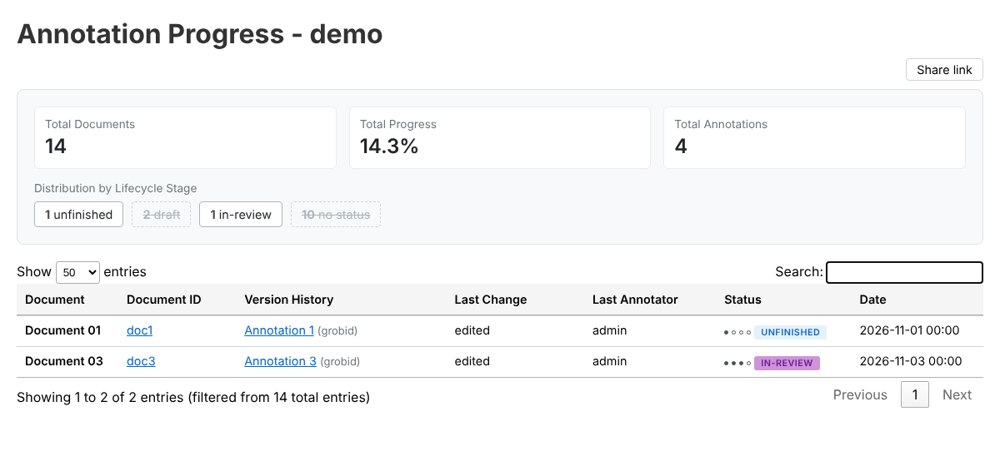

# Lifecycle stage filter in the annotation progress view

Implements [mpilhlt/pdf-tei-editor#505](https://github.com/mpilhlt/pdf-tei-editor/issues/505): in a collection with many documents, documents without annotations should be hidden on demand.

## Behavior

- The badges under "Distribution by Lifecycle Stage" are toggle buttons (`aria-pressed`). All are active when the page loads.
- Clicking a badge makes it inactive (grey, dashed border, crossed out) and hides the documents counted under its stage. Clicking it again shows them.
- A document is filtered as a whole, with all its version history rows, under the same stage it is counted under in the summary: the status of its representative version (`_select_representative_annotation`), or `no-status` if it has no annotations or no status from `annotation.lifecycle.order`. This keeps the counts and the filtered rows consistent.
- The filter combines with the search box (both are applied in the same DataTables search function).

## Implementation

- `routes.py`: the stage of each document is recorded while counting and written to the `data-stage` attribute of the document label in the table. Badges are rendered by `_stage_badge_html` with the same `data-stage` value.
- `HISTORY_TABLE_JS`: collects the stage per document group, keeps a set of hidden stages, and redraws the table on badge clicks.

## Verification

- Unit tests in `tests/test_annotation_progress.py` (`TestStageBadges`).
- The page was generated from `view_progress` with mocked repository data and driven in Chromium: hiding "no status" and "draft" left only the matching documents, re-activating "draft" restored them, the search still applied, no console errors.

