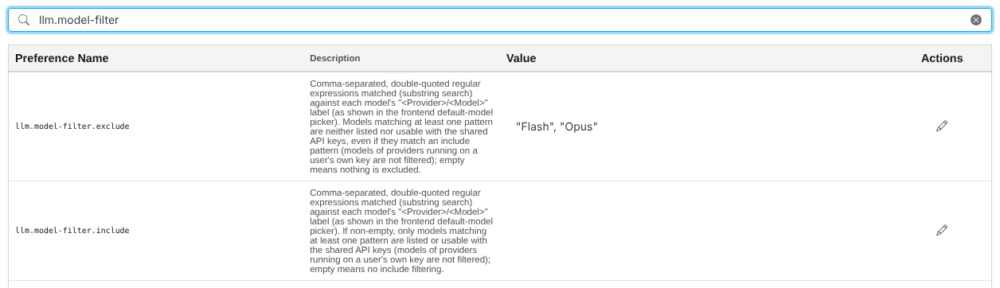

# LLM Reviewer: models and cost

This page is for administrators. It describes how to control which language models the LLM Reviewer (**Tools** > **Review document annotations** and the **LLM Review** button in focus mode) can use, what a review costs, and what to tell users when a review fails. How users choose a model is described in [Choosing a language model](https://github.com/mpilhlt/pdf-tei-editor/blob/main/docs/user-manual/language-models.md).

## The default model

The LLM Reviewer uses the model that is selected under **Tools** > **Inference**. When you select a model there as an administrator, the editor asks whether to make it the default model for all users. Choose a model that is good enough for the review and affordable for the number of documents your users review: the default model is the one model that users who are not administrators can use even if it costs money.

## Which models users can use

Users who are not administrators can select:

- the models their provider marks as free (for example those of KISSKI), and the models of inference endpoints marked as free;
- the default model;
- all models of providers that run on the user's own API key, since the user pays for them.

The server checks this on every review, not only in the menu.

## Restricting the models

Two settings in the **Configuration Editor** (**Tools** menu) limit the models of providers that run on a shared key. Search for `llm.model-filter`:

*Excluding all models whose name contains "Flash" or "Opus".*

- `llm.model-filter.include`: if set, only the models that match are listed and can be used.
- `llm.model-filter.exclude`: the models that match are neither listed nor usable, even if they also match `include`.

Each value is a list of patterns in double quotes, separated by commas. A pattern matches a model if it occurs anywhere in the model's full name as the menu shows it, `<Provider>/<Model>`, for example `KISSKI/llama-3.3-70b-instruct`. Upper and lower case count. The patterns are regular expressions, so `"^KISSKI/"` matches all KISSKI models and only those. Some examples:

| Setting | Value | Effect |
| --- | --- | --- |
| `llm.model-filter.include` | `"^KISSKI/"` | Only the KISSKI models |
| `llm.model-filter.include` | `"^KISSKI/", "Sonnet"` | The KISSKI models and all models with "Sonnet" in their name |
| `llm.model-filter.exclude` | `"Opus"` | All models except those with "Opus" in their name |

The models of providers that run on the user's own key are not filtered.

## Cost and duration

The reviewer sends the document to the model in parts of about 8,000 characters, one request after the other, and sends the annotation rules with every part. The cost of a review is therefore roughly the size of the rules times the number of parts, plus the document once. Segmentation documents are reviewed two pages at a time instead.

Reviewing a whole paper can take several minutes and, with a paid model, costs money each time. Reviewing single parts with **LLM Review** in focus mode is faster and cheaper. To keep the cost under control, make a free or inexpensive model the default and restrict the paid models with the filters above.

## When a review fails

- **The provider is unreachable, busy or rejects the request** (overload, rate limit, invalid model): the review stops with an error that names the part that failed. The suggestions for the earlier parts stay. Users can run the review again, or choose another model if the model is marked as busy in the menu.
- **The model's answer cannot be read**: the review fails with an error that shows the start of the answer. This usually means the model is not suitable for the review; choose another model.
- **Fewer suggestions than expected**: suggestions that quote a text that does not occur exactly once in the document are dropped, because the editor could not tell where they apply. The server log (`app.log`) records how many suggestions were kept for each part.
