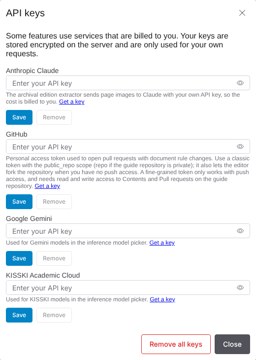

# Anthropic Claude

The models of Anthropic's Claude appear in the **Tools** > **Inference** menu under **Anthropic Claude**. They cost money per request.

## Your API key

Unless your administrator has set a shared key for everybody, the Claude models run on your own API key, so that the cost of your requests is billed to you. You can then use all Claude models.

1. Create a key in the [Anthropic Console](https://console.anthropic.com/settings/keys). You need an Anthropic account with credit.
2. Open **API Keys** in the user menu, paste the key under **Anthropic Claude** and click **Save**.

*Your API keys, one per service.*

**Get a key** below the field leads to the Anthropic Console. The key is stored encrypted on the server and used only for your own requests. **Remove** deletes it again.

The same key is used by the archival edition extractor, if your installation has it.

## With a shared key

If your administrator has set a shared key, it is used for all users. Users who are not administrators can then use a Claude model only if it is the default model. The administrator can restrict the models that are offered.
