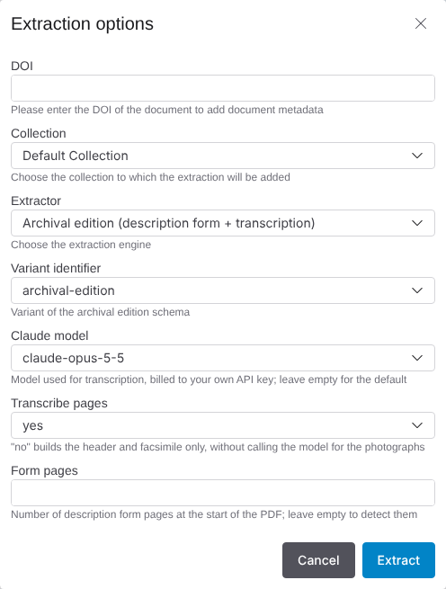
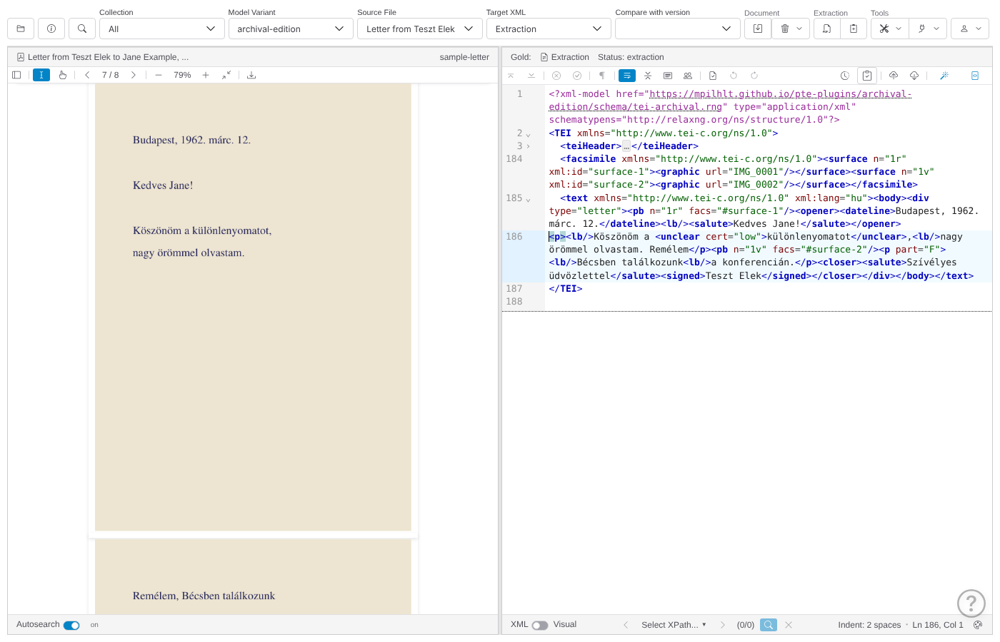

# Editing archival documents

The archival edition extractor turns photographs of archival documents, such as letters, postcards, telegrams, conference programs, manuscripts and notes, into a TEI edition. You describe the document in a form, and a Claude model transcribes the photographs page by page, diplomatically and in the languages of the document. You then check and correct the transcription in the editor.

## Preparing the PDF

1. Fill in the [Document Description Form](https://github.com/mpilhlt/pte-plugins/blob/main/plugins/archival-edition/src/pte_plugin_archival_edition/tests/fixtures/document-description-form.docx) for the document: who wrote it, when and where, to whom, in which languages, which persons are named, and so on. The form explains each field. Export it to PDF from Word.
2. Append the photographs of the document to the PDF, one per page and in reading order.

[schlote-letter-1906.pdf](https://github.com/mpilhlt/pte-plugins/blob/main/plugins/archival-edition/src/pte_plugin_archival_edition/tests/fixtures/schlote-letter-1906.pdf) is an example: the filled-in form followed by the scans of a handwritten letter from 1906.

If the form was printed, filled in by hand and scanned, it can be used as well: the model then reads the form, too.

## Running the extractor

Upload the PDF with the button for a new PDF in the **Extraction** group of the toolbar, or open it and click the button for extracting from the current PDF. Choose **Archival edition (description form + transcription)** as the extractor:

*The options of the archival edition extractor.*

- **Claude model**: the model that transcribes the photographs. Leave it empty to use the default model of your installation.
- **Transcribe pages**: with `no`, the extractor only builds the header from the form and one page per photograph, without calling the model, for example to transcribe the document yourself.
- **Form pages**: the number of pages of the form at the start of the PDF. Leave it empty to detect them: the pages of a form exported from Word have text, the photographs do not.

The transcription takes a while, one request to the model per page.

## Your Anthropic API key

The transcription runs on your own Anthropic API key, so that its cost is billed to you. When you start the first extraction, the editor asks for the key and stores it encrypted. You can change or remove it later under **API Keys** in the user menu. A key is created in the [Anthropic Console](https://console.anthropic.com/) under **API Keys**.

## Reviewing the transcription

The document opens next to the PDF. The header holds the data of the form, the text the transcription with a `<pb/>` element at the start of each photographed page.

*With Autosearch on, the PDF viewer shows the photograph of the page the cursor is on.*

The photographs have no text that the PDF viewer could search for. When **Autosearch** is on, the viewer therefore shows the photograph of the page the cursor is on, as given by the nearest `<pb/>` before it.

Check the transcription against the photographs, following the [review checklist](https://github.com/mpilhlt/pte-plugins/blob/main/plugins/archival-edition/docs/guidelines.md#review-checklist) of the guidelines. Unclear readings are marked with `<unclear>`; the guidelines describe all elements of the edition and how the fields of the form map to the TEI header. They are also published at <https://mpilhlt.github.io/pte-plugins/archival-edition/>.

To read the transcription without the markup, click **View XSL Transformations** (the file icon at the right end of the XML editor's toolbar) and choose **Archival edition (pages)**. It shows the text page by page.
