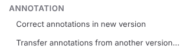

# Correcting and transferring annotations with a language model

Two entries in the **Annotation** section of the **Tools** menu let a language model change the annotation of the open document. Both save the result as a new version, so the version you started from stays as it is and you can compare the two or go back to it.

*The two entries in the Tools menu.*

- **Correct annotations in new version** checks the annotation of the open document against its annotation rules and corrects it, for example after an extraction.
- **Transfer annotations from another version** applies the annotation of another version to the text of the open one. Use it when the text has changed, for example after text recognition replaced the text layer of the PDF and the document was extracted again: the annotation decisions of the earlier version are not lost.

Both entries are available to annotators, reviewers and administrators, when the open document links to machine-readable annotation rules and is not a gold version. They use the model selected under **Tools** > **Inference** (see [Choosing a language model](https://github.com/mpilhlt/pdf-tei-editor/blob/main/docs/user-manual/language-models.md)). If an entry is disabled, hover over it to see why.

## Correcting the annotation

1. Open the version you want to correct and choose **Tools** > **Correct annotations in new version**.
2. Confirm the dialog, which names the model. Unsaved changes are saved first.
3. The document is read-only while the model works, also for other users and in other tabs. A progress bar shows how many units are done and how many were changed. You can minimize it and go on working on other documents, or cancel the correction with its cancel button.
4. When the model is done, the result is saved as a new version and loaded. If you have opened another document meanwhile, a dialog asks whether to load the new version.

The model sends back each unit (for example a reference) with its corrections. A corrected unit is taken only if it is well-formed XML and keeps the text of the unit; otherwise the original stays. The model does not change the text. Segmentation documents are corrected page by page.

If the model changes nothing, no version is created. If you cancel the correction or a request fails, a dialog asks whether to save the corrections made so far as a new version. The version you started from is frozen once a new version is derived from it, like after any other copy.

The new version records the model and the numbers of changed and unchanged units in its revision history.

## Transferring the annotation from another version

1. Open the version that should receive the annotation, usually the new extraction, and choose **Tools** > **Transfer annotations from another version…**.
2. Under **Take the annotation from**, choose the version whose annotation you want to keep. The gold version is preselected if there is one, else the most recently changed annotated version.
3. The dialog compares the two versions and shows how many units have the same text and are copied without the model, how many go to the model, and how many have no counterpart and are kept as extracted.
4. Optionally check **Mark units where the model disagrees with the earlier annotation** (see below), and click **Start**.

*Choosing the version to take the annotation from.*

The text of the open version is never changed; only the annotation is carried over. Progress, cancelling and saving work as for the correction. The transfer is refused if less than half of the earlier version's text is found in the open one.

With **Mark units where the model disagrees with the earlier annotation**, the model also checks the earlier decisions against the annotation rules. Where it is sure that a decision violates the rules, it marks the unit as not OK in [unit review](https://github.com/mpilhlt/pdf-tei-editor/blob/main/docs/user-manual/unit-review.md), with its reason as comment. The new version is then always loaded, so that you can go through the marks. Unit comments of the earlier version are not transferred.
