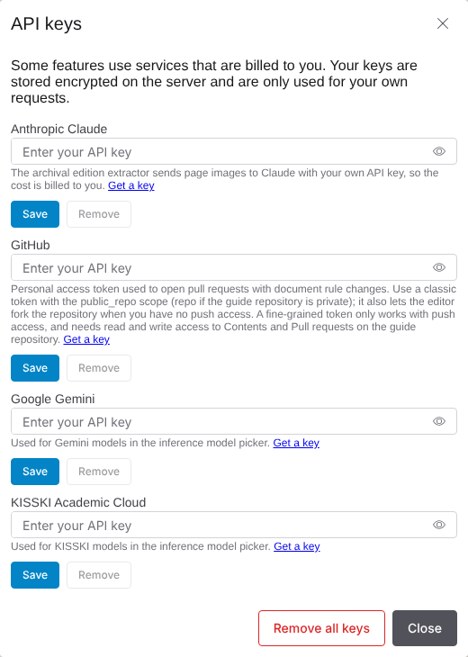

# Google Gemini

The Gemini models of Google appear in the **Tools** > **Inference** menu under **Google Gemini**. They are billed per request, although Google offers a free quota for some models.

## Your API key

Unless your administrator has set a shared key for everybody, the Gemini models run on your own API key, so that the cost of your requests is billed to you. You can then use all Gemini models.

1. Create a key in [Google AI Studio](https://aistudio.google.com/apikey) with your Google account.
2. Open **API Keys** in the user menu, paste the key under **Google Gemini** and click **Save**.

*Your API keys, one per service.*

**Get a key** below the field leads to Google AI Studio. The key is stored encrypted on the server and used only for your own requests. **Remove** deletes it again.

When the quota of your key is used up, Google refuses further requests for a while, or until the next day for a daily quota. Requests then fail with an error until the quota is available again; wait, or choose another model.

## With a shared key

If your administrator has set a shared key, it is used for all users. Users who are not administrators can then use a Gemini model only if it is the default model. The administrator can restrict the models that are offered.
