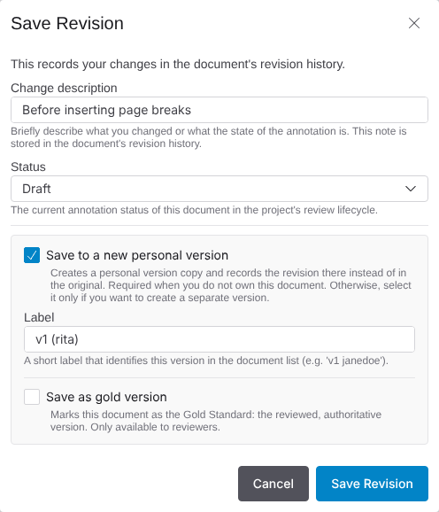
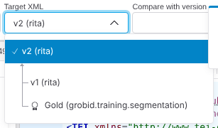
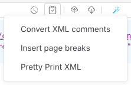
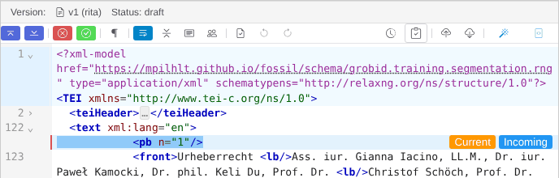
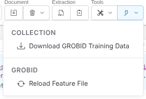
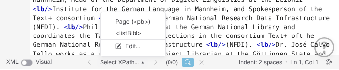
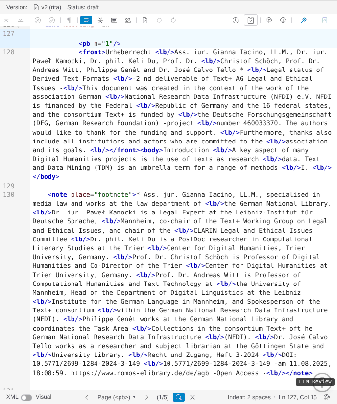
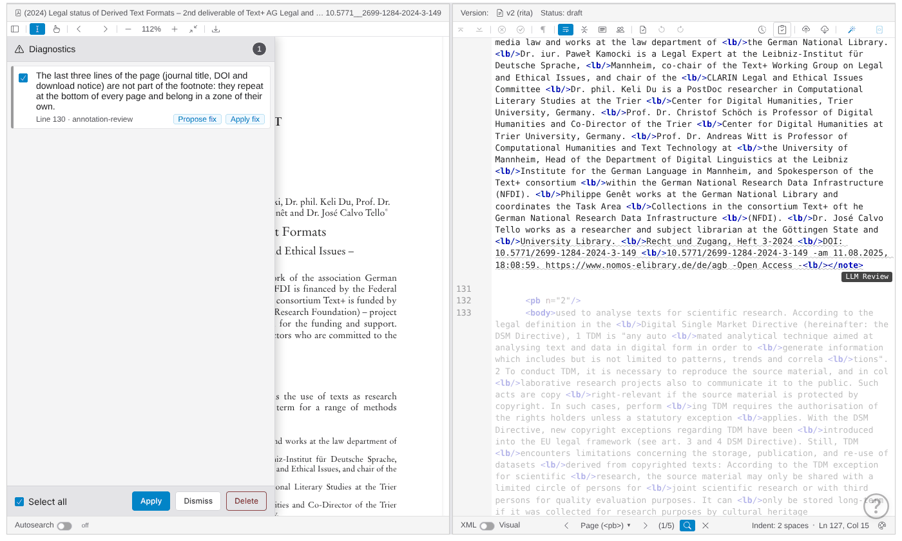
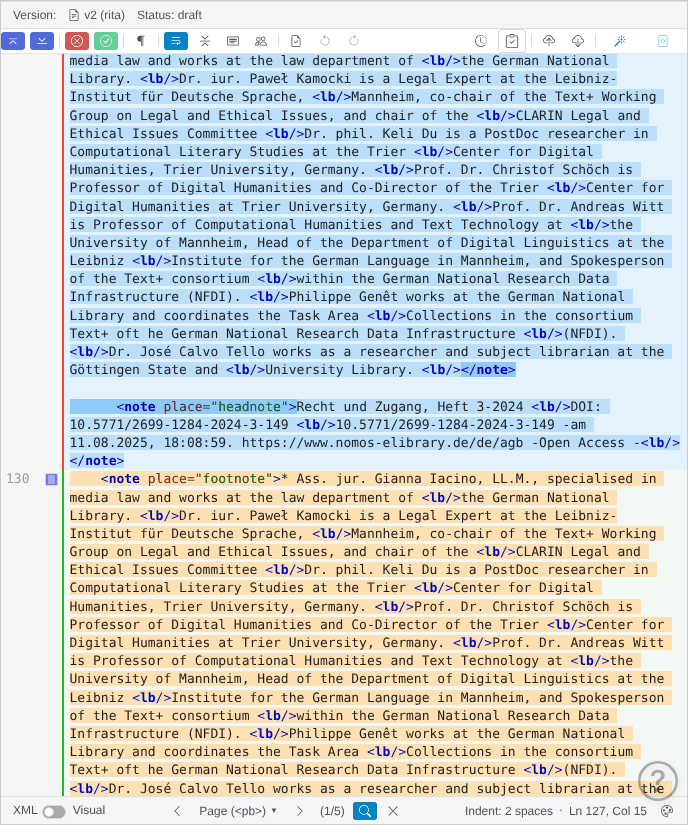

# How to use the LLM Reviewer with GROBID

The LLM Reviewer lets a language model read a GROBID training document and suggest corrections according to the annotation guidelines. You decide about every suggestion: nothing in the document changes until you accept it. This tutorial shows how to review a document part by part, which gives better results than reviewing it as a whole, and how to keep every step reversible.

You need:

- a GROBID training document that you can edit, for example a personal version of the gold version,
- a language model chosen under **Tools > Inference > Default Model**. If the menu lists no model, ask your administrator to set up a model provider.

## 1. Start every step with a new version

Before you change anything, save a new version of the document. If you don't like the result of a step, you go back to the version before it, and nothing is lost.

Click **Save revision** in the **Document** group of the toolbar, describe the next step under **Change description**, check **Save to a new personal version** and click **Save Revision**. Leave **Save as gold version** unchecked: the gold version is only set once the review is done.

*Saving a new version before the next step.*

The new version is now open, and the changes you make are saved in it automatically. The versions are listed in the **Target XML** menu, the newest at the top. Earlier versions are kept unchanged and become read-only once there is a newer one. To go back to an earlier version, select it there and save it as a new version again.

*Every step has its own version.*

## 2. Segmentation documents: add the page breaks

*Skip this section for the other GROBID variants, such as references or citations.*

The LLM Reviewer reviews segmentation documents (`grobid.training.segmentation`) page by page, so the document must know where each PDF page starts. This is marked with `<pb n="…"/>` (page beginning) elements. Documents extracted with a current version of the plugin already have them. In older documents, the **Page (`<pb>`)** navigation of the next step finds no page (it shows `(0/0)`). Add the page breaks like this:

1. Save a new version (step 1).
2. Click the magic wand button (**Enhance TEI**) at the right end of the XML editor toolbar and choose **Insert page breaks**.

   

   *Insert page breaks in the Enhance TEI menu.*

3. The editor shows the inserted `<pb/>` elements in the merge view. Only these milestones are added; the text, the line breaks and the zones stay as they are, and GROBID's training ignores them. Click the green check mark in the toolbar to accept all of them (the red cross rejects them).

   

   *The page breaks are inserted where each PDF page starts.*

If the enhancement says that the feature file is missing or does not match, the editor no longer has GROBID's layout information of this extraction, for example because the cache was cleared. Fetch it again with **Reload Feature File** in the plugins menu of the **Tools** group (reviewers only). This only downloads GROBID's layout information again; your annotations are not touched. Then run **Insert page breaks** again.

*Reload Feature File restores the layout information.*

## 3. Choose the parts to review

The node navigation in the statusbar of the XML editor moves through the document part by part. Click **Select XPath...** and choose what you want to review:

- **Page (`<pb>`)** in segmentation documents: one PDF page at a time,
- **`<bibl>`** in reference documents: one reference at a time.

*Choosing pages in a segmentation document.*

The magnifier button next to the counter switches on focus mode: everything outside the current part is dimmed, so that you can concentrate on it. **‹** and **›** (or the arrow keys) move to the previous or next part, and the counter shows where you are, for example `1/5` for the first of five pages. See [XPath Navigation](https://github.com/mpilhlt/pdf-tei-editor/blob/main/docs/user-manual/editing-workflow.md#xpath-navigation) and [Focus Mode](https://github.com/mpilhlt/pdf-tei-editor/blob/main/docs/user-manual/editing-workflow.md#focus-mode) in the user manual for details.

*The first page in focus mode, with the Annotation auto-review button.*

## 4. Review a part

Click **Annotation auto-review** at the bottom right of the part in focus. The model reads this part, and its suggestions appear in the **Diagnostics** panel on the left and as underlined text in the editor. Each suggestion explains what the model would change and why.

*A suggestion of the LLM Reviewer.*

For each suggestion you can:

- click **Propose fix** to see the change in the merge view, then accept it with the green check mark or reject it with the red cross,
- click **Apply fix** to apply it right away,
- uncheck it and click **Dismiss** if you don't agree.

*The proposed fix in the merge view.*

The model can be wrong. Check every suggestion against the PDF and the annotation guidelines before you accept it; if in doubt, dismiss it. Then move on to the next part with **›** and review it the same way.

If you spot errors of the text recognition on the page, such as misread letters or garbled footnote numbers, click **OCR auto-corrections**: the model suggests corrections of the text, which you accept or dismiss in the same way. The button of the page then becomes **Write text corrections to PDF**, which writes the accepted corrections of the page into the text layer of the PDF within seconds, without creating a new version. See [Editing with a Language Model](https://github.com/mpilhlt/pdf-tei-editor/blob/main/docs/user-manual/llm-editing-workflow.md) in the user manual.

**Tools > Annotation > Review document annotations** reviews the whole document in one go. This is handy for short documents, but for long ones the review by parts is easier to check.

## 5. Save and continue

Save a new version (step 1) before each larger step, for example before you review the next few pages. If the review of a part went wrong, select the previous version in the **Target XML** menu and continue from there.

When the document is done, hand it over to a reviewer as described in the [Review Workflow](https://github.com/mpilhlt/pdf-tei-editor/blob/main/docs/user-manual/review-workflow.md). See [Unit Review](https://github.com/mpilhlt/pdf-tei-editor/blob/main/docs/user-manual/unit-review.md#llm-reviewer) for how the LLM Reviewer records its review when review mode is on.
