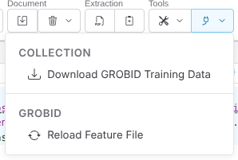

# Extracting GROBID training data

[GROBID](https://github.com/kermitt2/grobid) recognizes the parts of a scholarly PDF with a series of models: one finds the header, the body and the references on each page, others then split the header into title, authors and affiliations or a reference into its fields. Each model learns from its own training data. With the GROBID extractor, you let GROBID produce training data for a PDF, correct it in the editor and download the corrected data to retrain GROBID.

## Choosing a variant and a flavor

Click one of the two buttons in the **Extraction** group of the toolbar (upload a new PDF, or extract from the current PDF) and choose **GROBID Extraction** as the extractor. Two more fields appear:

*The variants of the GROBID extractor.*

**Variant identifier** chooses the model whose training data you want:

| Variant | Training data for |
| --- | --- |
| `grobid.training.segmentation` | Dividing the pages into header, body, footnotes, references, page headers and footers |
| `grobid.training.header` | The fields of the header: title, authors, abstract, keywords and so on |
| `grobid.training.header.authors` | The names of the authors in the header |
| `grobid.training.header.affiliation` | Affiliations and addresses in the header |
| `grobid.training.header.date` | Dates in the header |
| `grobid.training.references.referenceSegmenter` | Splitting the reference section into single references |
| `grobid.training.references` | The fields of a reference: authors, title, journal, year and so on |
| `grobid.training.references.authors` | The names of the authors in references |
| `grobid.training.table` | Tables |
| `grobid.training.figure` | Figures |

The two variants `grobid.service.fulltext` and `grobid.service.references` produce no training data, but GROBID's normal result: the full text, or only the references, as a TEI document.

**GROBID processing flavor** chooses the version of the GROBID models to use. `default` are GROBID's standard models; `article/footnotes-refs` are models for articles that give their references in footnotes, as is common in law and the humanities. The flavor is stored in the document, so that the training data later goes into the right folder.

Each extraction creates a new document of the chosen variant for the PDF. Switch between the variants of a PDF with **Model Variant** in the toolbar. How to correct a document and make the corrected version the gold version is described in the [Extraction Workflow](https://github.com/mpilhlt/pdf-tei-editor/blob/main/docs/user-manual/extraction-workflow.md).

## Page breaks in segmentation documents

In segmentation documents, a page break element `<pb n="…"/>` marks where each PDF page starts. The editor uses them to divide the document into pages, for example in the review and when moving from page to page in the XML editor. The extractor inserts them automatically. Documents extracted with an older version of the plugin may lack them: add them with **Insert page breaks** in the **Enhance TEI** menu, as described in [How to use the LLM Reviewer with GROBID](llm-review-tutorial.md#2-segmentation-documents-add-the-page-breaks).

## Reload feature file

Besides the training data, GROBID returns a *feature file* with the layout information of each word: on which page and line it stands, its font and so on. The editor keeps it and uses it to check your corrections: when the words of the document no longer match the words GROBID found in the PDF, for example because a word was deleted or typed in by accident, the XML editor marks the place with a warning.

When the feature file is missing, the check and **Insert page breaks** do not work. After GROBID's models have been retrained, the feature file can also be out of date. Reviewers can then fetch it again: open the document and choose **Reload Feature File** in the **GROBID** section of the plugins menu (plug icon).

*Reload Feature File in the plugins menu.*

A dialog first shows what the action does, which document it applies to, and whether the version of GROBID recorded in the document differs from the server's. Nothing happens until you click **Execute**; **Close** cancels.

*The confirmation before the feature file is reloaded.*

Reloading only replaces the layout information. Your annotations stay as they are, no new version is created, and the document is reloaded in the editor afterwards. The action is refused if the PDF was replaced after the extraction, for example by text recognition: the new PDF's layout no longer matches the text of the document, so the document has to be extracted again.

## Downloading the training data

When the documents of a collection have been corrected and marked as gold, reviewers download them for retraining GROBID:

1. Choose the collection under **Collection** in the toolbar.
2. Choose **Download GROBID Training Data** in the **GROBID** section of the plugins menu (plug icon).

The editor collects the gold version of each GROBID variant of each document in the collection, together with GROBID's feature files, and downloads them as a ZIP file. Its folders have the layout of GROBID's training data (`grobid-trainer/resources/dataset/`), sorted by model and flavor, so it can be unpacked there directly and the models retrained as described in the [GROBID documentation](https://grobid.readthedocs.io/en/latest/Training-the-models-of-Grobid/).

A progress indicator shows the documents being processed. If GROBID cannot process some documents, the download contains the others and a file `skipped-documents.txt` that names the skipped documents and the reason, and a message names them too.

## Importing training data

Reviewers can import existing GROBID training data, for example a corpus from GROBID's repository, so that it can be reviewed and corrected in the editor. Choose **Import GROBID Training Data** in the **GROBID** section of the plugins menu and upload a ZIP file that contains:

- the PDFs, named `{name}.pdf`,
- the annotations, named `{name}.training.{model}.tei.xml` (for example `{name}.training.segmentation.tei.xml` or `{name}.training.references.referenceSegmenter.tei.xml`),
- the feature files, named `{name}.training.{model}` without an extension.

These are the file names that GROBID gives the training data it creates. The files can be in any folder. Text and TSV files, such as a README, are ignored. In the form, choose the collection to import into and the flavor of the training data, and enter the GROBID revision that the feature files were computed with, if you know it. Without a revision, the documents are labeled `imported`.

Each annotation becomes the gold version of its document and variant. If the document already has a gold version of that variant, the annotation is imported as a new version instead. The imported feature files are used like the ones of an extraction: for checking corrections, for page breaks, which are inserted into segmentation documents during the import, and for the training data download. A document is skipped, and the form tells you why, if its PDF is missing from the ZIP file or if the collection already has a different PDF for it.
