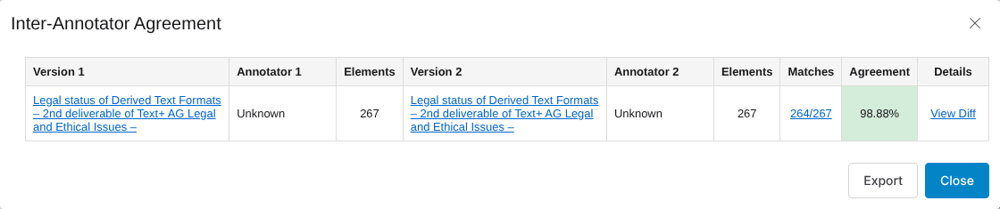
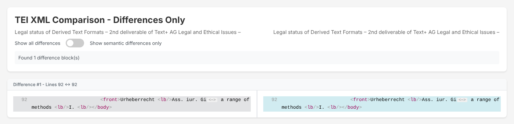

# Comparing annotators: inter-annotator agreement

When several people annotate the same document, or when you compare an extraction with its corrected version, the agreement between the versions shows how consistent the annotation is and where the annotators disagree. Typical uses are checking the quality of an extraction tool, validating training data and finding rules of the guidelines that annotators read differently.

## Computing the agreement

1. Open the PDF and choose the variant in **Model Variant** in the toolbar. All versions of this variant are compared, so each annotator should have saved their own version.
2. Choose **Compute Inter-Annotator Agreement** in the **Document** section of the plugins menu (plug icon).

The table lists every pair of versions:

*The agreement between two versions of a document.*

- **Version 1**, **Version 2**: the two versions. Click a title to open the version in the editor.
- **Annotator 1**, **Annotator 2**: who made the last change of each version, from its revision history.
- **Elements**: the number of elements in the text of each version.
- **Matches**: how many elements agree in tag, attributes and text. Click it to compare the two versions in the editor's merge view.
- **Agreement**: the share of matching elements; green from 80%, yellow from 60%, red below.
- **View Diff**: opens the differences in a separate window (see below).

**Export** downloads the table as a CSV file, for example to collect the agreement of many documents in a spreadsheet.

## Reviewing the differences

**View Diff** shows the places where the two versions differ, side by side:

*One difference between two versions.*

The switch at the top chooses what counts as a difference:

- **Show all differences** lists every difference, including identifiers, formatting and page breaks.
- **Show semantic differences only** ignores elements and attributes that do not concern the content, such as `xml:id` or `<pb>`. Use it to see the disagreements that matter for the annotation. The administrator configures which elements and attributes are ignored.

Click a line of a difference to open that version in the editor at this line and correct it.
