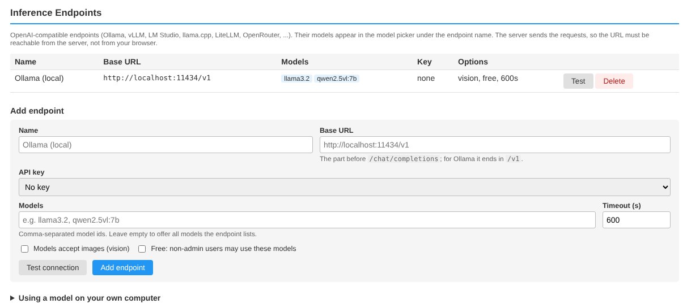

# Adding inference endpoints

An inference endpoint is a server that runs language models and answers requests in the format of the OpenAI API, for example [Ollama](https://ollama.com), vLLM, LM Studio, the llama.cpp server, LiteLLM or OpenRouter. Administrators can add any number of them. The models of each endpoint then appear in the **Tools** menu under **Inference** and can be used by the LLM functions of the editor, such as the LLM Reviewer, the LLamore extractor and the automatic annotation.

## Adding an endpoint

Open the plugins menu (plug icon) in the toolbar and choose **Inference endpoints** in the **Inference** section. The page lists the endpoints that are set up, with buttons to test and delete them, and the form to add one below.

*The Inference Endpoints page with an Ollama endpoint on the same computer.*

Fill in the form and click **Add endpoint**:

| Field | Meaning |
| --- | --- |
| Name | Name of the provider in the model menu; its models appear as `<Name>/<model>` |
| Base URL | The address of the endpoint's API, for example `http://localhost:11434/v1` for Ollama. See [Models on your own computer](#models-on-your-own-computer) |
| API key | **No key**; **Shared key, used for all users**, which you enter here; or **Each user enters their own key**: users then enter it under **API Keys** in the user menu, and the requests run on their key |
| Models | The models to offer, separated by commas. Leave it empty to offer all models the endpoint lists |
| Models accept images (vision) | The models can read images, for example the page images of a PDF |
| Free | Users who are not administrators may use the models. Otherwise only administrators can use them, unless one of them is the default model |
| Timeout (s) | How long to wait for an answer. Local models can be slow, so the default is 600 seconds |

**Test connection** asks the endpoint for its models before you add it, and **Test** in the table does the same for an endpoint that is already set up. The result shows the models the endpoint offers, or the error.

An endpoint cannot be changed after it was added. To change it, delete it and add it again.

## Models on your own computer

The editor's server sends the requests to the endpoint, not your browser. This has two consequences:

- The endpoint must be reachable from the server. `localhost` in the base URL means the machine or container the editor runs on, which is not your computer if the editor runs on a server.
- Settings for browsers, such as Ollama's `OLLAMA_ORIGINS`, are not needed.

Which base URL to use for Ollama on your own computer depends on where the editor runs:

| The editor runs | Base URL |
| --- | --- |
| On your computer | `http://localhost:11434/v1` |
| On your computer, in Docker | `http://host.docker.internal:11434/v1`. On Linux, the container has to be started with `--add-host=host.docker.internal:host-gateway`, and Ollama has to listen on all interfaces (`OLLAMA_HOST=0.0.0.0`) |
| On a server | The server cannot reach your computer directly. Connect the two through a VPN such as Tailscale (`http://<machine>.<tailnet>.ts.net:11434/v1`, with `OLLAMA_HOST=0.0.0.0`) or an SSH tunnel from your computer (`ssh -N -R 11434:localhost:11434 user@server`, then `http://localhost:11434/v1`). Tunnel services such as ngrok or Cloudflare Tunnel work too, but they make Ollama, which has no password protection, reachable for everybody: put a proxy that checks a key in front of it and enter that key as the API key |

## Restrictions

- Only administrators can see and change the endpoints.
- The base URL must start with `http://` or `https://` and must not contain a user name, password, query or fragment. Addresses in the local network are allowed, but not link-local addresses (`169.254.x.x`, which cloud servers use for internal services). The server operator can restrict the endpoints to particular hosts.
- API keys are stored encrypted and are never shown again.
