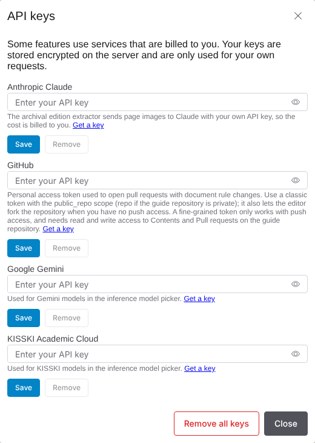

# KISSKI Academic Cloud

The KISSKI LLM service of the GWDG (Academic Cloud) offers open language models, such as Llama, Qwen and Gemma, to members of academic institutions free of charge. Its models appear in the **Tools** > **Inference** menu under **KISSKI Academic Cloud** and are marked as free, so all users can choose them.

## Your API key

Unless your administrator has set a shared key for everybody, the KISSKI models run on your own API key.

1. Request a key in the [KISSKI dashboard](https://saia.gwdg.de/dashboard), with the account of your institution (Academic Cloud).
2. Open **API Keys** in the user menu, paste the key under **KISSKI Academic Cloud** and click **Save**.

*Your API keys, one per service.*

**Get a key** below the field leads to the KISSKI dashboard. The key is stored encrypted on the server and used only for your own requests. **Remove** deletes it again.

## With a shared key

If your administrator has set a shared key, it is used for all users, and nobody needs a key of their own. The extraction of structured data from PDFs with KISSKI models works only with a shared key.
